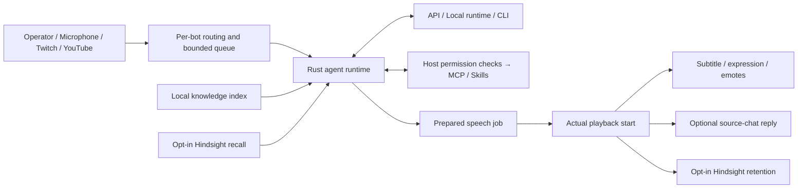

# Architecture

The desktop control room is Svelte 5/TypeScript. Tauri 2 runs a Rust host. Three.js and three-vrm render bundled or imported characters. Local model runtimes, provider CLIs, Hindsight and MCP servers are separately installed services/processes.

## Source map

| Component | Location | Responsibility |
| --- | --- | --- |
| Control room | `src/App.svelte` | Profiles, settings, queue and presentation state |
| Avatar | `src/lib/avatar.ts` | GLB/VRM rendering, rig adaptation and gestures |
| Speech | `src/lib/audio.ts`, `presentation.ts` | Audio readiness, amplitude and cancellable emote timing |
| Wake phrases | `src/components/WakeWord.svelte`, `src/lib/wake-word.ts` | Explicit capture lifecycle, VAD, transcription and phrase matching |
| Agent | `src-tauri/src/agent.rs` | Context, automatic retrieval and bounded tool rounds |
| Providers | `providers.rs`, `cli_provider.rs`, `transcription.rs` | Dialog, CLI and STT adapters |
| Persistence | `storage.rs`, `knowledge.rs`, `memory.rs` | Per-bot SQLite/files, PDF/text indexing, Hindsight |
| Output and input | `overlay.rs`, `chat.rs` | Native/OBS outputs, playback acknowledgement and stream APIs |
| Extensions | `mcp.rs`, agent skill helpers | MCP transport and host-enforced permissions |

## Invariants

A bot's profile scope is fixed at the beginning of a request. Changing the editor selection cannot reroute an in-flight reply. Dialog and speech turns are queued while multiple avatars can remain visible. Output generation IDs and cancellation flags suppress late audio, emotes and chat replies. Text-only mode has an explicit presentation start.

Knowledge is locally indexed on import. Relevant excerpts are retrieved without model tools and carry source metadata. Hindsight is separately enabled and only retains new presented turns; no bulk profile/history/knowledge upload occurs. Retrieved sources are untrusted context. The local recent-history setting is short-term context, not another long-term memory provider.

Credentials remain in the OS store. Local and remote provider choices are independent for dialog, STT, TTS and memory. The host, rather than the model, decides which tools viewers/operators may execute. CLI built-in tool access is restricted in favor of the host bridge. This does not sandbox trusted local MCP processes or explicitly enabled skill scripts at OS level.
