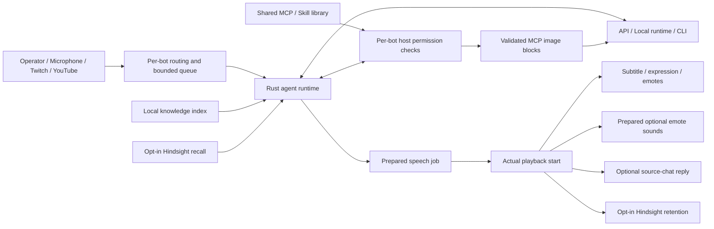

# Architecture

The desktop control room is Svelte 5/TypeScript. Tauri 2 runs a Rust host. Three.js and three-vrm render bundled or imported characters. Local model runtimes, provider CLIs, Hindsight and MCP servers are separately installed services/processes.

This document describes source version **0.5.0**.

## Source map

| Component | Location | Responsibility |
| --- | --- | --- |
| Control room | `src/App.svelte`, `src/lib/shortcuts.ts`, `src/components/HelpTip.svelte` | Profiles, settings, queue, scoped keyboard actions and focus/hover help |
| Avatar | `src/lib/avatar.ts` | GLB/VRM rendering, rig adaptation and gestures |
| Speech and effects | `src/lib/audio.ts`, `presentation.ts`, `emote-audio.ts`; `emote_audio.rs` | Audio readiness, amplitude, cancellable emote timing and bot-scoped optional clips |
| Wake phrases | `src/components/WakeWord.svelte`, `src/lib/wake-word.ts` | Explicit capture lifecycle, VAD, transcription and phrase matching |
| Agent | `src-tauri/src/agent.rs` | Context, automatic retrieval and bounded tool rounds |
| Providers and vision | `providers.rs`, `cli_provider.rs`, `transcription.rs`, `vision.rs` | Dialog/CLI/STT adapters and bounded native image transport |
| Persistence | `storage.rs`, `knowledge.rs`, `memory.rs` | Per-bot SQLite/files, PDF/text indexing, Hindsight |
| Output and input | `overlay.rs`, `chat.rs` | Native/OBS outputs, playback acknowledgement and stream APIs |
| Extensions | `extensions.rs`, `mcp.rs`, `skill_library.rs`, `storage.rs` | Shared definitions/packages, per-bot bindings, transport and host-enforced permissions |
| App control MCP | `control_mcp.rs`, `src/components/ControlMcpSetup.svelte` | Local MCP endpoint, bounded host actions, explicit library installation and external-client configuration |

## Extension scope

MCP definitions are installed once in the SQLite `mcp_library` catalog. Profiles store server IDs plus `enabled`, `allowedTools` and `viewerAllowedTools`; effective profiles hydrate the shared definition. MCP connections are shared by server ID. Editing or disconnecting a server affects its consumers, while tool grants remain independent for every bot. Server-side session/data isolation is outside the host's guarantee.

Skills are installed under `library/skills/<id>`. Each bot stores its `skillsEnabled` IDs and a separate `allowSkillScripts` flag. Fresh bots receive no automatic extension grants; copying settings copies bindings rather than package contents. The model initially sees only ID/name/description of granted skills. Full instructions and resources are loaded on demand, with the current bot grant rechecked at access. `AGENTS.md`, `PERSONA.md`, knowledge and history remain scoped to `profiles/<id>` or that bot's database records.

Legacy migration deduplicates equivalent packages/definitions, assigns distinct IDs to conflicting skill contents and commits bot-binding changes transactionally. Legacy skill folders are retained. Profile packages contain only that bot's assigned extensions and resources; import preserves unrelated library entries and resets sensitive runtime opt-ins. Installing or importing an extension never grants it to unrelated bots.

The optional built-in control extension persists only `{transport:"builtin", builtin:"cohost-control"}` plus its library identity. Runtime connection resolves it to the current loopback `/mcp` endpoint and an independent ephemeral Bearer token, never a persistent fake URL or an OBS session token. **MCP + Skill installieren** installs this definition and the bundled `cohost-control` skill without connecting, granting tools, enabling scripts or starting a dialog. An explicit operator-only IPC copies current JSON/TOML client configuration. External clients holding this token act as operators on the offered control surface; internal bot grants do not constrain them. Both port and token change at app restart.

`control_mcp.rs` implements stateless JSON Streamable HTTP: legacy initialize/initialized for 2025-03-26, 2025-06-18 and 2025-11-25, plus modern 2026-07-28 discovery and per-request metadata/header validation. It provides ping, tools/list and tools/call, with no SSE, protocol sessions, sampling or model calls. Host/Origin/Bearer validation, a 16 KiB request limit, 2 KiB tool arguments, eight concurrent requests, 120 requests/minute and a 64 KiB response limit bound this local surface. HTTP and JSON-RPC failures remain separate from `CallToolResult.isError` execution failures.

The fixed control tools expose whitelisted public bot/emote summaries, allowChat emote dispatch, native show/hide, a pause request and global stop. Generic calls cannot identify a trusted viewer origin, so even operator calls enforce `allowChat=true` for emotes. Show/hide use `generation.try_lock()` plus a pending-speech check and return busy errors rather than waiting on their own calling turn or changing an active output snapshot. Global stop cancels without acquiring the generation lock; stop/pause events notify the control room. A pause result confirms request dispatch, not UI acknowledgement. No tool can send new dialog requests or modify files, settings, prompts, grants or credentials.

For internal bot turns, `agent.rs` intercepts the built-in `cohost_perform_emote` after MCP permission checks, restricts it to the current turn's bot and still requires `allowChat=true`. It adds the validated emote to the presentation queue, preserving actual speech/text-start timing and cancellation. External HTTP callers use immediate host dispatch; they do not enter the agent loop. This distinction prevents internal control tools from displaying gestures while the model is still preparing its reply.

## Presentation and image transport

An emote may carry `sound` and `soundVolume` (0–1). Empty sound means silence. `builtin:wave`, `builtin:cheer` and `builtin:whoosh` are synthesized locally. Imported WAV/MP3/OGG/WebM/M4A files use `custom:<uuid>.<ext>` IDs under `profiles/<id>/sounds`; reads require that the ID is assigned to an emote of that bot. Import and serving enforce size, header, path and symlink checks. Native IPC and the session/bot-scoped OBS endpoint expose audio data, not arbitrary filesystem paths.

Each output prepares and decodes selected effects before speech presentation, then starts each prepared sound synchronously beside its gesture. Effects use their own gain and audio context, capped at 15 seconds per clip, eight distinct prepared sounds and a 16 MiB decoded cache. Missing or browser-blocked effects warn without failing TTS. Cancellation invalidates pending preparation and stops playing sources. Browser audio policy still requires user activation where applicable.

MCP image content is validated before the textual tool result is bounded. The agent carries actual pixels as native image blocks to the next model request, keeping textual tool results in their original call/result sequence. OpenAI-compatible providers (including suitable Ollama/LM Studio endpoints) receive multimodal message arrays; Anthropic receives base64 image blocks. Codex App Server receives image input items; Claude Code uses Stream-JSON input with image blocks. The selected model must support these inputs.

`model.visionEnabled` controls forwarding per bot; it grants no tool permission. PNG/JPEG/WebP/GIF inputs are bounded across all tool rounds to four images per turn, 5 MiB per image and 12 MiB combined file bytes after Base64 decoding. Claude Code additionally rejects encoded stdin envelopes above 10 MiB. The host does not load arbitrary URLs or file paths from tool results. Disabled forwarding, known text-only models and unsupported image requests produce explicit errors rather than silently discarding the image. Codex also rejects image turns before inference when the actual selected model's catalog metadata cannot confirm image support. Model catalogs cannot guarantee provider access or capability where metadata is absent. Tool text and visual content remain untrusted observations.

Wake-phrase capture has separate session and audio-segment generations. Blocking for speech, effects or manual capture invalidates segments without losing an explicitly requested listening session, including during initial permission/profile-save waits. Transient recording/transcription errors retry with bounded backoff; explicit stop, bot/provider changes and permanent microphone failures end the session. External sound heartbeats renew short-lived wakeword blocks so a disconnected renderer cannot leave capture paused indefinitely.

## Invariants

A bot's profile scope is fixed at the beginning of a request. Changing the editor selection cannot reroute an in-flight reply. Dialog and speech turns are queued while multiple avatars can remain visible. Output generation IDs and cancellation flags suppress late audio, emotes and chat replies. Text-only mode has an explicit presentation start.

Knowledge is locally indexed on import. Relevant excerpts are retrieved without model tools and carry source metadata. Hindsight is separately enabled and only retains new presented turns; no bulk profile/history/knowledge upload occurs. Retrieved sources are untrusted context. The local recent-history setting is short-term context, not another long-term memory provider.

Credentials remain in the OS store. Local and remote provider choices are independent for dialog, STT, TTS and memory. The host, rather than the model, decides which tools viewers/operators may execute. CLI built-in tool access is restricted in favor of the host bridge. This does not sandbox trusted local MCP processes or explicitly enabled skill scripts at OS level.

Keyboard routing respects input fields and modal scope: `?`/F1 opens help, Ctrl/Cmd+S saves the current editor, Ctrl/Cmd+K focuses the studio composer, Ctrl/Cmd+Enter sends from the studio, and Alt/Option+1–7 navigates outside text entry. Escape dismisses a visible tooltip/help/dialog before falling back to global stop.

The Linux GTK dependency uses vendored GLib 0.18.5 with the original upstream iterator correction for GHSA-wrw7-89jp-8q8g. Linux CI/release workflows verify source hashes and run a focused optimized regression. The version is unchanged; see [the backport record](../vendor/glib/COHOST-BACKPORT.md), [SECURITY.md](../SECURITY.md) and [RELEASING.md](RELEASING.md). Local/mock regression tests are distinct from live provider verification; no paid or live provider validation is claimed here.
